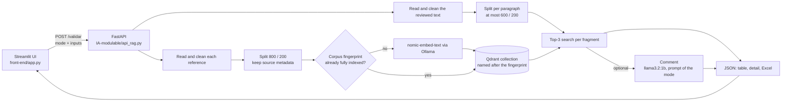

# Source Review RAG

Review a text, fragment by fragment, against references you choose. For every fragment of the text
under review, the app retrieves the most similar passages from your references and shows where each
one comes from: file, page or paragraph, title, outlet, date and URL when you provide them. A local
LLM can optionally add a comment, off by default.

Everything runs on your machine with Ollama and Qdrant. No document is sent to an external service.

**It finds passages for a person to read. It does not decide whether a text is correct.** There is no
fact-checking verdict, truth probability, coverage score or approval. See [Limitations](#limitations).

## The three modes

| Stable ID | Name in the UI | Reference | Text under review |
|---|---|---|---|
| `text_vs_text` | Texto vs. texto | A text or document you choose | Another text or document |
| `report_vs_news` | Informe vs. noticia | A report, press release or original document | A news item commenting on it |
| `news_vs_newsletter` | Noticias vs. newsletter | One or several news items | A newsletter |

News vs. news and original vs. summary are covered by `text_vs_text`.

All three use **the same pipeline**. A mode only changes the input labels and help, how many references
are accepted, and the prompt of the optional comment.

The operation is **directional**: each fragment of the reviewed text becomes a search over the
reference. It is not an exhaustive two-way comparison or a style diff. The user picks the references,
and being the reference does not make a text true. In `news_vs_newsletter` the search runs directly over
all the news items at once; no verdicts from earlier comparisons are added up.

## Quick start

Checked on macOS (Intel, CPU only) with Python 3.12 and Ollama 0.40.11.

**Prerequisites:** Python 3.12 and [Ollama](https://ollama.com/download) running. Docker is not needed:
Qdrant runs embedded in the API process and stores its data in `qdrant_storage/` inside this folder.

```bash
python3.12 -m venv .venv
.venv/bin/pip install -r requirements.txt

ollama pull nomic-embed-text      # embeddings (274 MB), required
ollama pull llama3.2:1b           # optional comment (1.3 GB)
```

Start the backend and the UI in two terminals, both from the project root:

```bash
# terminal 1: API on http://localhost:8010
.venv/bin/uvicorn api_rag:app --app-dir IA-modulable --port 8010

# terminal 2: UI on http://localhost:8511
.venv/bin/streamlit run front-end/app.py
```

Open <http://localhost:8511>, choose a mode, paste or upload the two inputs and press **Revisar**. The UI
is in Spanish.

## Input and output

**Input.** Each input is either pasted UTF-8 text or uploaded files (PDF, DOCX, TXT, Markdown), never
both: the UI sends only the selected origin and the API rejects a mix. JSON is not required for any mode.

- `text_vs_text` and `report_vs_news` take exactly one reference.
- `news_vs_newsletter` takes one or several. Pasted text always counts as **one** reference, because the
  app does not guess where one article ends and another begins. Upload one file per news item to know
  which item each passage comes from.
- Title, outlet, date and URL are optional per reference, and nothing is invented when they are empty.
  A URL is only kept as a link: it is never downloaded.

**Output.** For each reviewed fragment: its text and location, up to three passages with their source and
location, the cosine similarity of each passage and, if requested, the model comment or the reason it
failed. The Excel export has three sheets: `Resultados`, `Referencias` and `Resumen`.

**Locations.** PDFs report the real page. Other formats report the paragraph, counted over blank lines in
the normalised text, as well as character offsets into that normalised text.

**Whole text by default.** "Analizar solo el inicio" keeps the first fragments, not a random sample, and
the result states how many fragments were left unreviewed and from where.

## How it works



Key modules in `IA-modulable/`: `modalidades.py` (the three modes), `prompt.py` (one prompt per mode),
`RAG3.py` (reading, cleaning, splitting, query loop), `X_qderant.py` (embeddings, index, search),
`X_AGENT.py` (LLM), `api_rag.py` (HTTP contract).

### Decisions

- **The index is keyed by content.** The collection name is a hash of the fragments, their metadata, the
  embedding model and the splitter configuration, so changed documents can never silently query an old
  corpus. A collection is reused only if it holds all the expected points; an interrupted indexing run
  is discarded and repeated.
- **Reviewed paragraphs are not merged.** With the default splitter, a newsletter of short sentences
  collapsed into one fragment mixing several claims. Each paragraph is now its own review unit, split
  further only above 600 characters. The reference keeps its 800/200 chunks so that passages carry context.
- **No "no evidence" threshold.** Claims absent from the references can still get fairly high
  similarities, so a cut-off would give false assurance.
- **Provided texts are data.** They are delimited in the prompt, cannot close those delimiters, and the
  prompt tells the model to ignore instructions inside them. This reduces the risk of prompt injection but
  does not eliminate it.

## API

`POST /validar`. Exactly one of `file_ref` / `texto_ref` and one of `file_query` / `texto_query` is required.

| Field | Type | Description |
|---|---|---|
| `modalidad` | text, required | One of the three stable IDs. Anything else returns 400, with no fallback |
| `file_ref` | file, repeatable | Reference file(s): PDF, DOCX, TXT or Markdown |
| `texto_ref` | text | Pasted reference (one reference) |
| `ref_metadata` | JSON text, optional | One object per reference, in order, with any of `title`, `outlet`, `date`, `url` |
| `file_query` | file | Text under review as a file |
| `texto_query` | text | Text under review, pasted |
| `usar_agente` | bool, default `false` | Add the LLM comment |
| `fraccion_inicial` | float in (0, 1], default `1` | Review only the first fraction of the fragments |

```bash
curl -s -X POST localhost:8010/validar \
  -F modalidad=report_vs_news \
  -F file_ref=@examples/synthetic/normativa_sintetica_pd.pdf \
  -F 'texto_query=Una exposición entra en default con más de 60 días de impago.'
```

Response shape (abridged):

```json
{
  "modalidad": "report_vs_news",
  "modalidad_nombre": "Informe vs. noticia",
  "comentario_solicitado": false,
  "referencias": [{"ref_id": "R1", "filename": "normativa_sintetica_pd.pdf", "title": null, "outlet": null, "date": null, "url": null}],
  "indice": {"coleccion": "srr_…", "fragmentos": 6, "reutilizado": false},
  "texto_revisado": {"filename": "Texto pegado (revisado)", "fragmentos_totales": 1, "fragmentos_revisados": 1, "fragmentos_sin_revisar": 0, "sin_revisar_desde": null},
  "resultados": [{
    "fragmento": 1,
    "chunk": "Una exposición entra en default con más de 60 días de impago.",
    "chunk_location": {"filename": "Texto pegado (revisado)", "page": null, "paragraph": 1, "paragraph_end": 1, "char_start": 0, "char_end": 61, "location": "párr. 1"},
    "relevant_chunks": ["…", "…", "…"],
    "sources": [{"ref_id": "R1", "filename": "normativa_sintetica_pd.pdf", "page": 1, "paragraph": null, "paragraph_end": null, "char_start": 0, "char_end": 720, "location": "p. 1", "title": null, "outlet": null, "date": null, "url": null}],
    "scores": [0.7133, 0.6388, 0.6335],
    "context": "[R1 · p. 1] normativa_sintetica_pd.pdf\n…"
  }]
}
```

With `usar_agente=true`, each result also has `comentario`, plus `comentario_error` if generation failed.

| Situation | Response |
|---|---|
| Invalid input: unknown mode, empty text, unsupported or unreadable file, non-UTF-8 text, mixed inputs, too many references | 400 with the reason |
| Embedding, indexing or search failure | 500 with the cause, never an empty success |
| Comment failure | 200 with the passages kept and `comentario_error` set on that fragment |

`GET /colecciones` lists this project's collections, for diagnostics.

## Configuration

Defaults are in [`IA-modulable/config/config.yaml`](IA-modulable/config/config.yaml). Values can be
overridden with environment variables or a `.env` file in the project root (see
[`.env.example`](.env.example)). No API keys are needed.

| Variable | Default | Purpose |
|---|---|---|
| `OLLAMA_HOST_NAME` / `OLLAMA_PORT` | `localhost` / `11434` | Ollama server |
| `EMBED_MODEL` | `nomic-embed-text` | Embedding model |
| `LLM_MODEL` | `llama3.2:1b` | Model for the optional comment |
| `LLM_MAX_TOKENS` / `LLM_TIMEOUT_S` | `512` / `300` | Limits per comment; long comments are cut off |
| `QDRANT_LOCATION` | `qdrant_storage` | Local path relative to the project root, a server URL or `:memory:` |
| `API_URL` | `http://localhost:8010` | Backend URL used by the UI |

## Limitations

- **Quality has not been measured.** There is no evaluation of retrieval or comments for these three
  modes, and this README makes no accuracy claim. The bank-document metrics of the original thesis do not
  apply here.
- **Similarity is not support.** It measures closeness between texts. Up to three passages are always
  returned, even when none is relevant.
- **Top-3 is not the whole document.** A fact missing from the retrieved passages may still be in the
  reference.
- **The default comment model is unreliable.** In manual checks during development, `llama3.2:1b` read
  figures wrongly, attributed claims to organisations that appeared in none of the texts, and missed a
  60-versus-90-day discrepancy even though the relevant passage had been retrieved first. Treat comments
  as hints and read the passages. Using a larger model through `LLM_MODEL` is possible but has not been
  assessed either.
- **Speed.** Comments took tens of seconds per fragment on a CPU-only laptop; this is an observation, not
  a benchmark. Requests are handled one at a time, and embedded Qdrant allows a single API process.
- **Segmentation.** Headings become their own fragments in texts with blank lines. PDF text usually has no
  blank lines, so PDFs are reviewed per page in chunks of up to 600 characters.
- **Not covered.** No OCR for scanned PDFs, no automatic separation of pasted articles, no importing from
  links, no RSS or news APIs, and no multi-user support. Mixed-language comparison has not been assessed,
  and comments are written in Spanish.
- **Storage grows.** Each distinct corpus gets its own collection. To free the space, stop the API and
  delete `qdrant_storage/`.

## Tests and CI

```bash
.venv/bin/pip install -r requirements-dev.txt
.venv/bin/python -m pytest -q
```

| What | Runs | External services |
|---|---|---|
| `pytest` (`tests/test_*.py`) | Modes and prompt selection, input formats and errors, aggregated search, sources through to Excel, index fingerprint and partial indexes, retrieval without LLM, UI with `AppTest` | None: in-memory Qdrant and **test doubles** for embeddings and the LLM |
| `tests/smoke_e2e.py` | The three modes against a running API, with minimal temporary inputs. Add `--con-comentario` to also generate comments | **Real** embeddings and embedded Qdrant; real LLM with the flag |

The smoke script confirms the path works; it does not assess quality. The GitHub Actions workflow in
`.github/workflows/ci.yml` runs both without the LLM, but it has not been run yet because this repository
has no remote.

## Origin

This project is an adaptation of a master's thesis (TFM) prototype by José Tuñón, a local RAG for
validating credit-risk model documentation. The thesis project remains separate and unchanged. The
pipeline, stack and chunk sizes come from it. The adaptation to this general-purpose text review, carried
out with an AI coding assistant (Claude Code), removed the banking modes and SAS processing, and added
the three modes, pasted text and TXT/Markdown input, source and location tracing, the content-keyed index
and the new prompts.

## Repository layout

```
IA-modulable/          backend: FastAPI app, modes, pipeline, Qdrant handler, prompts, config
front-end/             Streamlit UI (app.py) and its testable helpers (presentacion.py)
tests/                 pytest suite and the end-to-end smoke script
examples/synthetic/    fictitious PDF and DOCX files used by the tests
.streamlit/            UI port and settings
```

## Data and licensing

- Keep your own documents out of the repository. `qdrant_storage/` and `*.xlsx` are git-ignored because
  they contain or quote what you reviewed.
- Third-party components are listed in [THIRD_PARTY_NOTICES.md](THIRD_PARTY_NOTICES.md).
- **License:** none chosen yet, so all rights are reserved by default.
