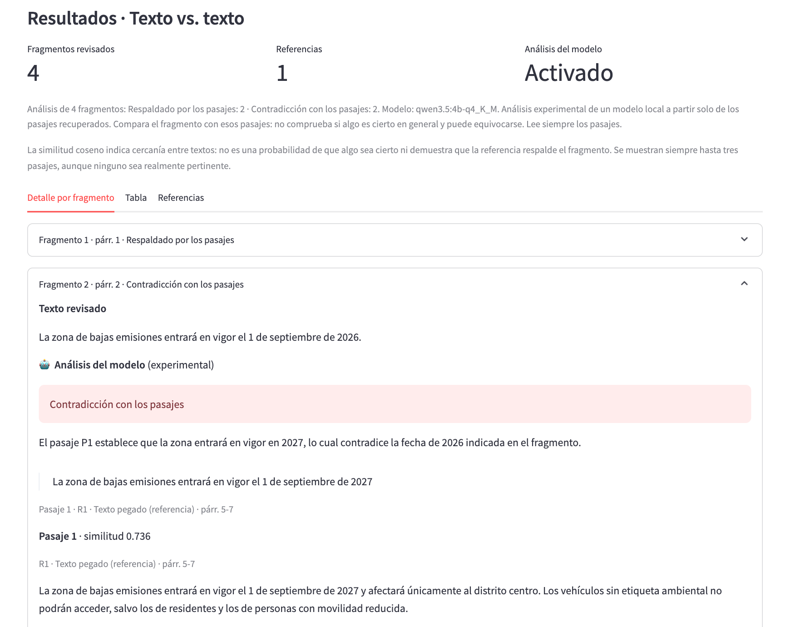
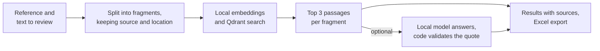

# Source Review RAG

Check a text against the sources you choose, on your own computer, with every result traced back to a passage you can read.

For each fragment of the text under review, the app finds the most similar passages in your references and shows where they come from: file,
page or paragraph, title, outlet, date and URL. If you switch it on, a small local model also compares the fragment with those passages and
quotes the words its answer relies on. The code then checks that those words are really there.

The project also measures its own choices. Three local models were compared on the same cases, and the chosen one was then tested inside the
real application, failures included.

**It helps a person review a text. It does not decide what is true.** Everything is a comparison with the references you picked, and being the
reference does not make a text correct.

## Three ways to use it

| Mode (the interface is in Spanish) | You provide | For example |
|---|---|---|
| **Texto vs. texto** | A text and another one to compare it with | Does this summary match the plan it describes? The plan says 2027, the summary says 2026 |
| **Informe vs. noticia** | A report and a news item about it | The guide says more than 90 days, the article says more than 60 |
| **Noticias vs. newsletter** | One or several news items and a newsletter | A newsletter gives €90 million for an investment that the original story puts at €40 million |



*The real interface with synthetic data, on a fragment that contradicts its reference.*

## How it works



With the analysis on, each fragment ends in one of these states:

- **Respaldado por los pasajes**, **Contradicción con los pasajes** or **Información insuficiente en los pasajes**, with an explanation and a literal quote when there is one.
- **Resultado no validado**: the model answered, but its evidence could not be checked, so no label is shown.
- **Análisis no disponible**: a technical failure, such as a time limit. It is never presented as a lack of evidence.

The passages and the export are kept in every case. [How it works](docs/how-it-works.md) has the details, and [the API page](docs/api.md) covers calling it directly.

## Quick start

Checked from a fresh clone on macOS (Intel, CPU only) with Python 3.12 and Ollama 0.40.14. Docker is not needed: Qdrant runs inside the API process.

You need Python 3.12 and [Ollama](https://ollama.com/download), running. Then:

```bash
python3.12 -m venv .venv
.venv/bin/pip install -r requirements.txt

ollama pull nomic-embed-text      # embeddings (274 MB), required
ollama pull qwen3.5:4b-q4_K_M     # optional analysis (3.3 GB)
```

Start the backend and the interface in two terminals, both from the project root:

```bash
# terminal 1: API on http://localhost:8010
.venv/bin/uvicorn api_rag:app --app-dir IA-modulable --port 8010

# terminal 2: interface on http://localhost:8511
.venv/bin/streamlit run front-end/app.py
```

Open <http://localhost:8511>, choose a mode, paste or upload the two inputs and press **Revisar**.

**The analysis is off by default.** To use it, tick *Añadir análisis del modelo*. Having the model configured or installed triggers nothing on its own. If it is missing, the app says so and
gives the `ollama pull` command. It keeps working without the model, never downloads one during a query and does not switch to another.

### Configuration

Defaults are in [`config.yaml`](IA-modulable/config/config.yaml). Override them with environment variables or a `.env` file ([example](.env.example)). No API keys are needed.

| Variable | Default | Purpose |
|---|---|---|
| `LLM_MODEL` | `qwen3.5:4b-q4_K_M` | Model for the analysis. `llama3.2:1b` and `qwen3.5:9b-q4_K_M` also work, if installed |
| `LLM_MAX_TOKENS` / `LLM_TIMEOUT_S` | `256` / `120` | Limits per fragment. An answer cut off or out of time gets no label |
| `LLM_NUM_THREAD` | Chosen by Ollama | CPU threads for the analysis. The measurements below used 8 |
| `OLLAMA_HOST_NAME` / `OLLAMA_PORT` | `localhost` / `11434` | Ollama server |
| `EMBED_MODEL` | `nomic-embed-text` | Embedding model |
| `QDRANT_LOCATION` | `qdrant_storage` | Local path, server URL or `:memory:` |
| `API_URL` | `http://localhost:8010` | Backend used by the interface |

## Choosing the model

Three models labelled the same 30 claims against the same passages, with the protocol and the choice rule fixed in advance.

| Model | Correct, pass 1 and 2 | Wrongly supported, pass 1 and 2 | Median per request, pass 1 |
|---|---|---|---|
| `llama3.2:1b` | 8/30, 9/30 | 14/20, 13/20 | 8.1 s |
| `qwen3.5:4b-q4_K_M` | 29/30, 30/30 | 1/20, 0/20 | 21.8 s |
| `qwen3.5:9b-q4_K_M` | 27/30, 28/30 | 0/20, 0/20 | 38.8 s |

**Read these numbers for what they are.** They come from 30 synthetic cases written and labelled by the assistant that ran the comparison, with no human review and the evidence already given, on one CPU-only
laptop. They describe that benchmark, not real news and not the application as a whole.

**Why the 4B.** It is a large step up from the 1B, which wrongly supported most of the claims it should not have. Against the 9B it is a question of balance. The 9B never wrongly supported a claim in either pass, while the 4B did once, so anyone who puts that first has a real
reason to prefer it. But the 9B took almost twice as long, and it was not more accurate overall on this set. These models differ in more than their number of parameters, so the comparison does not show that size alone explains the gap.

The full method, failures and data are in [the comparison report](docs/model-comparison.md) and [its results](benchmarks/results/2026-11-05_protocol-v1/).

## Testing it inside the application

The comparison evaluated a benchmark script. After choosing the 4B, the same judge was moved into the application and tested separately, on one pass, with production code. These are also synthetic cases written by the assistant, with no human review.

| What was run | Correct as shown | No result | Wrongly supported |
|---|---|---|---|
| The 30 known cases | 28/30 | 2 | 0/20 |
| 15 control cases, 5 of them unseen by the final prompt | 14/15 | 1 | 0/10 |
| One document per mode through the API, 14 fragments | 13/14 | 1 | none |

A rejected answer counts as not correct, even when its raw label was right. There were no technical failures, and the page and Excel file matched what the model returned.

The first run of this check was worth having: two extra prompt rules had made the model lose its evidence on a 60 vs. 90 day contrast that the benchmark's judge had resolved. That run is published along with the fix. It also found mistakes that remain, including one validated explanation that says a restriction applies to the people it actually exempts. The quote was right, and
the sentence around it was not. **The analysis stays experimental for that reason: read the passages.** Details are in [the integration check](docs/integration-check.md).

## A deliberately small setup

This was built and measured with a small model on an Intel laptop from 2019 (Core i9-9880H, 16 GB of memory), with Ollama running on the CPU and no GPU acceleration. It does not need dedicated high-end hardware, but you do have to wait:

| Measured on that laptop | Time |
|---|---|
| Passages only, for a short document | About 2 s |
| Analysis of one fragment in a document, typical (first one includes about 6 s loading the model) | About 31 s |
| Full document with analysis, 4 fragments | 2 to 2.5 min |
| Full document with analysis, 6 fragments | About 3 min |

This is not real-time. It suits a review you can leave running, and the time grows with the number of fragments. Other machines will differ.

If you need faster answers and can send your texts to a hosted model, services such as Claude are an obvious alternative. This project has not been compared with them, so it says nothing about how they rank.

## Where your data goes

Reading the code path, with the default settings:

- **Models.** With Ollama on `localhost`, embedding and generation requests are processed on your machine. This setup does not need to send your documents to a hosted model API, and the code has no such integration.
- **Interface.** It talks to the API at `API_URL`, by default on `localhost`. URLs you add as metadata are kept as links and never fetched by the app.
- **What stays on disk.** Qdrant keeps your passages and their embeddings in `qdrant_storage/` until you delete that folder, and this project adds no encryption. Excel files stay wherever you save them.
- **Logs.** The API prints the first characters of each fragment to its console. Ollama and Streamlit have their own logging, which this project does not control.
- **Network.** Installing dependencies and pulling models needs a connection. Streamlit's usage statistics are switched off in [`.streamlit/config.toml`](.streamlit/config.toml).
- **What changes this.** If `OLLAMA_HOST_NAME` or `QDRANT_LOCATION` point to another machine, your texts go there.

This describes the project's own code, not a security audit: third-party libraries and the operating system were not inspected, and it makes no claim of absolute privacy or of regulatory compliance. It also says nothing about the tools used to develop the project (see [How this was built](#how-this-was-built)).

Keep your own documents out of the repository. `qdrant_storage/` and `*.xlsx` are git-ignored because they contain or quote what you reviewed.

## Limitations

- **Quality is measured only on small synthetic sets.** Search itself has not been evaluated, and no person has reviewed the models' explanations.
- **A valid quote does not prove a correct reading.** It shows that the words are in the passage, not that the explanation is right or that it picked the sentence that settles the claim.
- **Similarity is not support.** It measures closeness between texts. Up to three passages are always returned, even when none is relevant.
- **Top 3 is not the whole document.** A fact missing from the passages may still be in the reference.
- **Answers can vary.** The same prompt has produced different answers between runs, even with temperature 0 and a fixed seed.
- **The quote check is strict.** It rejects a correct quote whose first letter was capitalised, so some right answers show no result.
- **Prompt injection is reduced, not eliminated.** Texts are delimited and treated as data in the prompt.
- **Segmentation.** PDF text usually has no blank lines, so PDFs are reviewed per page in chunks of up to 600 characters. Headings can become their own fragments in other formats.
- **Not covered.** No OCR for scanned PDFs, no automatic separation of pasted articles, no importing from links, no multi-user support, and requests run one at a time. Mixed-language comparison has not been assessed, and explanations are in Spanish.
- **Storage grows.** Each distinct set of references gets its own collection. To free the space, stop the API and delete `qdrant_storage/`.

## Tests and reproduction

```bash
.venv/bin/pip install -r requirements-dev.txt
.venv/bin/python -m pytest -q        # no models needed: Ollama is replaced by test doubles

# with the API running, three modes with real embeddings; --con-analisis also uses the model
.venv/bin/python tests/smoke_e2e.py
```

GitHub Actions runs both on each pull request, with real embeddings and no generative model, since those are only run locally. Passing tests show that the software behaves as specified, and say nothing about the quality of a model's answers.

The evaluations are reproducible from [`benchmarks/`](benchmarks/README.md), which holds the protocol, datasets, runners and every saved answer. The frozen comparison needs about 10 GB of models and hours on a CPU, and the integration check takes about half an hour.

## How this was built

This is an adaptation of a master's thesis (TFM) prototype by José Tuñón, a local RAG for validating credit-risk model documentation, which remains a separate project. Its pipeline, stack and chunk sizes carried over. The adaptation into a general-purpose review tool, the benchmark, the integration and this documentation
were done with an AI coding assistant (Claude Code), with commits marked accordingly. The assistant also wrote and labelled the evaluation cases and reviewed the explanations reported here, and that is not a human review.

## Repository layout

```
IA-modulable/          backend: API, modes, pipeline, Qdrant handler, analysis, configuration
front-end/             Streamlit interface and its testable helpers
tests/                 pytest suite and the smoke script
benchmarks/            protocol, datasets, runners and saved results
docs/                  how it works, API, model comparison, integration check
examples/synthetic/    fictitious documents used by the tests
```

Third-party components are listed in [THIRD_PARTY_NOTICES.md](THIRD_PARTY_NOTICES.md).

**License:** none chosen yet, so all rights are reserved by default.
