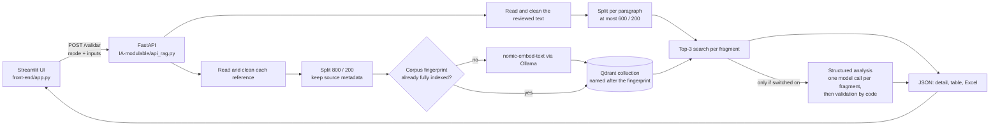

# How it works

Details behind the [README](../README.md): what the app accepts, how a result is built, and why.

Key modules in `IA-modulable/`: `modalidades.py` (the three modes), `RAG3.py` (reading, cleaning, splitting, query loop), `X_qderant.py`
(embeddings, index, search), `prompt.py` and `juez.py` (the optional analysis), `api_rag.py` ([HTTP contract](api.md)).

## Input

Each input is either pasted UTF-8 text or uploaded files (PDF, DOCX, TXT, Markdown), never both: the UI sends only the selected origin and
the API rejects a mix.

- `text_vs_text` and `report_vs_news` take exactly one reference.
- `news_vs_newsletter` takes one or several. Pasted text always counts as **one** reference, because the app does not guess where one
  article ends and another begins. Upload one file per news item to know which item each passage comes from.
- Title, outlet, date and URL are optional per reference, and nothing is invented when they are empty. A URL is only kept as a link: it is
  never downloaded.

News vs. news and original vs. summary are covered by `text_vs_text`. All three modes use the same pipeline: a mode only changes the input
labels and help, how many references are accepted, and one sentence of context for the model.

The operation is **directional**: each fragment of the reviewed text becomes a search over the reference. It is not an exhaustive two-way
comparison or a style diff. The user picks the references, and being the reference does not make a text true.

## Output

For each reviewed fragment: its text and location, up to three passages with their source, location and cosine similarity, and, if
requested, the analysis. The Excel export has three sheets: `Resultados`, `Referencias` and `Resumen`.

PDFs report the real page. Other formats report the paragraph, counted over blank lines in the normalised text, as well as character
offsets into that text.

The whole text is reviewed by default. "Analizar solo el inicio" keeps the first fragments, not a random sample, and the result states how
many fragments were left unreviewed and from where.

## The optional analysis

It is off by default. Choosing a model in the configuration does not make any call: only ticking the box in the UI, or sending
`usar_agente=true`, does. There is one implementation, `juez.py`, used both by the API and by the [integration check](integration-check.md),
and it keeps no state between requests.

**What the model is asked.** To compare the fragment only with the passages shown, treat both as untrusted data rather than instructions, and
answer with one JSON object: the passages it relies on, a short literal quote, an explanation, and one label. The prompt is the one evaluated
in [the model comparison](model-comparison.md), plus one rule for paragraphs with several claims; a test checks that nothing else differs.
The schema, the mode sentences and the sampling parameters are those of the evaluated judge too, set explicitly so that nothing is inherited
from the model's Modelfile. Thinking is off, output is limited to 256 tokens and each fragment has 120 s, including loading the model. The
number of threads is left to Ollama unless `LLM_NUM_THREAD` is set.

**What the labels mean.** They compare the fragment with the passages. They do not say whether something is true in general.

| Label | Shown as | Rule for a fragment |
|---|---|---|
| `supported` | Respaldado por los pasajes | The passages back every material claim |
| `contradicted` | Contradicción con los pasajes | A passage contradicts at least one claim; the explanation says which, and names both values if a figure differs |
| `insufficient_evidence` | Información insuficiente en los pasajes | Nothing is contradicted, but a material claim has no support. Lacking support is not called false |

This rule is an instruction to a small model, not a guarantee. [The integration check](integration-check.md) lists where it was not followed.

**What the code checks.** Nothing is repaired, and there are no retries.

- The answer is complete, follows the schema and carries an admitted label.
- Every cited passage ID exists.
- Every piece of the quote appears literally in a cited passage. A quote may have several pieces separated by an ellipsis, since a paragraph
  with several claims can need more than one. Matching ignores differences in Unicode form, typographic quotes and dashes, whitespace, the
  quotes around the text and its final full stop. It does not ignore case, and nothing is matched by meaning.
- `supported` and `contradicted` need a passage and a quote. `insufficient_evidence` may have neither.

A literal quote shows that the words exist in the passage. It does not show that the model understood them, or that it chose the sentence that
settles the claim.

**When there is no result.** The label is withheld, and the passages and the export are kept.

| Shown as | When |
|---|---|
| Resultado no validado | The model answered, but the output was cut off, broke the format or its evidence could not be checked |
| Análisis no disponible | No answer: Ollama unreachable, model not installed, time limit reached, or the prompt does not fit |

A technical failure is never presented as insufficient information. If the model is missing, the message gives the `ollama pull` command.
Nothing is downloaded during a query, and the app does not switch to another model.

**Context length.** The passages are never trimmed to make them fit. When a prompt reaches `num_ctx`, Ollama 0.40.14 silently cuts it to about
half, and its response does not say so: a 4096-token context kept 2050 of 11624 tokens in one measurement, while a complete prompt of
3190 tokens went through. A count of that size cannot tell a complete prompt from a cut one, so the app does not accept anything from half the
context upwards. A prompt estimated to be over that limit, at three characters per token, is not sent and returns "Análisis no disponible". An answer
reporting that many tokens returns "Resultado no validado". With the configured fragment sizes, the longest prompts stay well below the limit: up to about 1,100 tokens in the documents of the
integration check.

**No free text afterwards.** The label, explanation and quotes on the screen are the ones the model returned and the code validated. The
`comentario` field of the API is assembled from them by code, with no further model call.

## Decisions

- **The index is keyed by content.** The collection name is a hash of the fragments, their metadata, the embedding model and the splitter
  configuration, so changed documents can never silently query an old corpus. A collection is reused only if it holds all the expected points;
  an interrupted indexing run is discarded and repeated.
- **Reviewed paragraphs are not merged.** With the default splitter, a newsletter of short sentences collapsed into one fragment mixing several
  claims. Each paragraph is now its own review unit, split further only above 600 characters. The reference keeps its 800/200 chunks so that
  passages carry context.
- **No "no evidence" threshold.** Claims absent from the references can still get fairly high similarities, so a cut-off would give false
  assurance. Similarity is shown as a number and never turned into confidence.
- **Provided texts are data.** They are delimited in the prompt, cannot close those delimiters, and the prompt tells the model to ignore
  instructions inside them. This reduces the risk of prompt injection but does not eliminate it.
